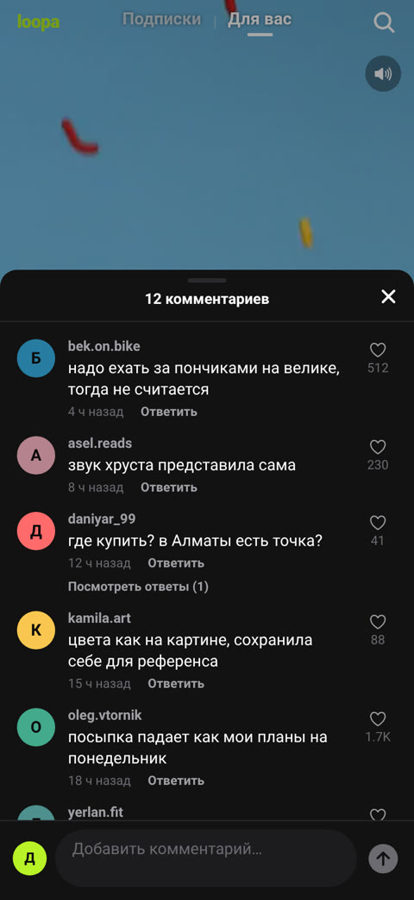
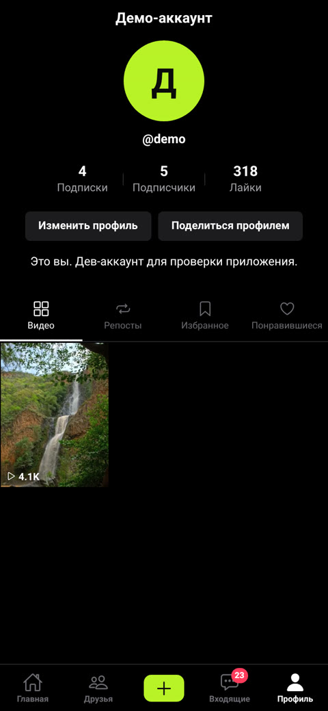
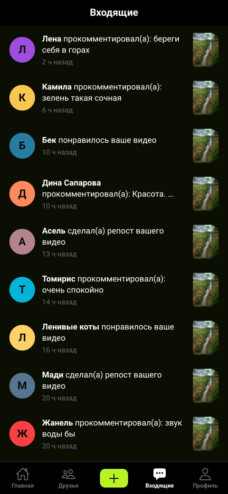
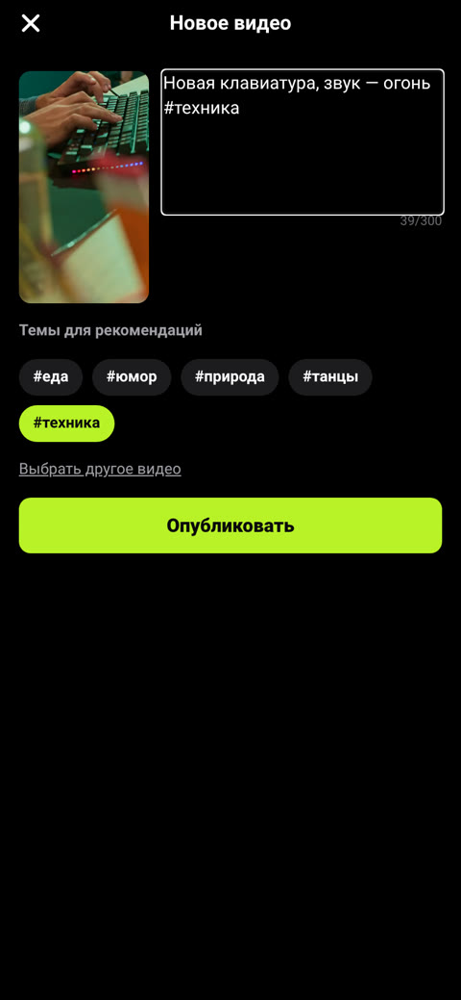

# Loopa

[](https://github.com/nurymyn/Loopa/actions/workflows/ci.yml)

Loopa — приложение коротких вертикальных видео: лента «Для вас» и «Подписки», лайки, комментарии, подписки,
уведомления, съёмка и публикация своих роликов. Мобильное приложение на Expo (открывается в Expo Go по QR-коду),
сервер на Node.js + Fastify, все данные хранятся в PostgreSQL.

Проект собран по гайду «Свой TikTok за 8 шагов» (шаги 1–8, бонус и финальная полировка) и доработан сверх него:
настоящая камера, аккаунты с паролем, репосты, страницы хэштегов и звуков, тесты и CI.
Соответствие шагам гайда — в [docs/GUIDE-MAPPING.md](docs/GUIDE-MAPPING.md).

| Лента | Комментарии | Профиль | Входящие | Публикация |
|---|---|---|---|---|
|  |  |  |  |  |

Скриншоты сняты с веб-сборки этого же приложения (`expo export --platform web`) в headless Chromium с экраном
390×844 и реальным API с демо-данными. Это не макеты. На телефоне интерфейс тот же, но шрифты и иконки
системные. Ещё скриншоты: [вход](docs/screenshots/login.jpg), [поделиться](docs/screenshots/share.jpg),
[друзья](docs/screenshots/friends.jpg), [хэштег](docs/screenshots/hashtag.jpg), [поиск](docs/screenshots/search.jpg),
[интересы](docs/screenshots/interests.jpg). Экран камеры в браузере без камеры не снять, его скриншота нет.

## Что умеет

- **Лента.** Вертикальные видео на весь экран, свайп вверх/вниз. Играет только видимое видео, следующее
  подгружается заранее. До первого кадра показывается превью, без чёрных вспышек. Видео на паузе, когда вы ушли
  с вкладки, открыли комментарии или свернули приложение. Тап — пауза/плей, тонкая полоска прогресса внизу,
  кнопка звука, видео идёт по кругу. Сверху вкладки «Подписки | Для вас».
- **Лайки.** Двойной тап — большое красное сердце в месте нажатия, кнопка-сердце с пульсом, вибрация.
- **Комментарии.** Шторка на 70% экрана, закрывается крестиком или свайпом вниз. Ответы на комментарии,
  лайки комментариев, новый комментарий появляется сверху.
- **Репост и ссылки.** Репост кладёт видео во вкладку «Репосты» вашего профиля. «Поделиться…» открывает
  системное меню со ссылкой на веб-страницу видео (`/v/:id`, с превью для мессенджеров). «Скопировать ссылку».
- **Профиль.** Имя, фото (загрузка из галереи), @ник, счётчики, био. Вкладки «Видео», «Репосты», «Избранное»,
  «Понравившиеся». Списки подписчиков и подписок с кнопками «Подписаться».
- **Камера.** «+» открывает камеру: запись до 60 секунд с кольцом прогресса, передняя/задняя камера, вспышка,
  таймер 3 секунды, выбор из галереи. Дальше превью, подпись с #хэштегами, «Опубликовать» с полосой загрузки.
  Опубликованное видео первым появляется в «Для вас» и в профиле.
- **Аккаунты.** Регистрация и вход по @нику и паролю. Кнопка «Войти как демо» для проверки. Два телефона — два
  разных человека, которые видят лайки и комментарии друг друга.
- **Входящие.** Лайки, комментарии, ответы, подписки (с кнопкой «Взаимно»), репосты. Красный счётчик
  непрочитанного на вкладке, при открытии всё помечается прочитанным.
- **Друзья.** «Ваши подписки» и «Рекомендуемые аккаунты».
- **Поиск.** По людям, подписям, звукам и #хэштегам, недавние запросы. Страница хэштега и страница звука.
- **«Для вас».** Простой алгоритм: теги видео (еда, юмор, природа, танцы, техника), учитываются лайки и
  досмотры до конца, любимые темы показываются чаще, 20% ленты — случайные видео. Скрытый экран интересов
  открывается тройным тапом по логотипу «loopa».
- Везде, где есть списки, работает «потяни, чтобы обновить» и подгрузка при прокрутке (кроме экранов «Друзья»
  и «Поиск», там списки короткие и приходят целиком).
- Если сервер недоступен, приложение показывает понятное сообщение с кнопкой «Повторить», а не падает.

## Чем Loopa лучше демо из видео

| Что | В видео (Lolkek) | В Loopa |
|---|---|---|
| Где хранятся данные | В приложении, после перезапуска всё пропадает | PostgreSQL на сервере, видно с любого телефона |
| Запуск | React Native CLI, Android-эмулятор | Expo Go на своём телефоне по QR-коду |
| Камера | Заглушка «запись симулирована» | Настоящая запись до 60 с, смена камеры, вспышка, таймер 3 с |
| Публикация | Нет | Загрузка на сервер с прогрессом, видео первым в ленте |
| Аккаунты | Нет | Регистрация и вход по нику и паролю, демо-вход |
| Репост | Копирует ссылку | Репост в профиль + системное «Поделиться» + веб-страница видео с превью |
| Воспроизведение | Играет видимое видео | Плюс предзагрузка следующего, превью до первого кадра, пауза при сворачивании, прогресс, звук вкл/выкл |
| Рекомендации | Нет | Алгоритм по тегам, лайкам и досмотрам, 20% случайных, экран интересов |
| Комментарии | Список | Ответы, лайки комментариев, шторка со свайпом |
| Поиск | Экран поиска | Люди, подписи, хэштеги, звуки, недавние запросы, страницы хэштегов и звуков |
| Уведомления | Экран со списком | Реальные события от других людей, счётчик непрочитанного |
| Профиль | Видео, лайки, сохранённые | Плюс репосты, фото профиля, редактирование, списки подписчиков |
| Тесты и CI | Нет | 20 тестов API на настоящем PostgreSQL, проверка типов, GitHub Actions |

## Как это устроено

```
 Телефон (Expo Go)                         Компьютер / сервер
┌─────────────────────┐   HTTP + JSON    ┌───────────────────────────┐      ┌──────────────┐
│ mobile/  Expo SDK 58 │ ───────────────▶ │ server/  Fastify + TS     │ ───▶ │ PostgreSQL 16 │
│ expo-router          │   Bearer-токен   │ /api/...  REST            │  pg  │ users, videos │
│ expo-video, -camera  │ ◀─────────────── │ /media/... видео и превью │      │ likes, ...    │
└─────────────────────┘                  │ /v/:id  страница видео    │      └──────────────┘
                                         └─────────────┬─────────────┘
                                                       │ файлы
                                              media/ (демо-ролики), server/uploads/ (загрузки)
```

Подробно — в [docs/ARCHITECTURE.md](docs/ARCHITECTURE.md), схема базы — в [docs/DATABASE.md](docs/DATABASE.md).

## Стек

- **Мобильное приложение:** Expo SDK 58 (React Native 0.88, React 19), TypeScript strict, expo-router,
  expo-video, expo-camera, expo-image-picker, expo-secure-store, expo-haptics, expo-clipboard, react-native-svg.
  Все модули есть в Expo Go, отдельная сборка не нужна.
- **Сервер:** Node.js 22, TypeScript strict, Fastify 5, `pg`. Пароли — `scrypt` из `node:crypto`, без лишних
  библиотек. Миграции — пронумерованные SQL-файлы.
- **База данных:** PostgreSQL 16, расширение `pg_trgm` для поиска.
- **Проверки:** `node:test` против настоящей базы, GitHub Actions.

## Быстрый старт

Нужно: компьютер (Windows, macOS или Linux) и телефон в одной Wi-Fi сети.

1. **Установите программы** (один раз):
   - [Node.js 22 LTS](https://nodejs.org/);
   - [Docker Desktop](https://www.docker.com/products/docker-desktop/) — в нём будет работать PostgreSQL;
   - [ffmpeg](https://ffmpeg.org/download.html) — нужен, чтобы скачать демо-видео
     (macOS: `brew install ffmpeg`, Windows: `winget install ffmpeg`, Ubuntu: `sudo apt install ffmpeg`);
   - на телефон — приложение **Expo Go** из App Store или Google Play.
2. **Скачайте проект и установите зависимости:**
   ```bash
   git clone https://github.com/nurymyn/Loopa.git
   cd Loopa
   npm run setup
   ```
3. **Запустите базу данных и подготовьте её:**
   ```bash
   docker compose up -d          # PostgreSQL 16 в Docker
   npm run media                 # скачать 10 демо-роликов (один раз)
   npm run migrate && npm run seed
   ```
   `seed` стирает все данные в базе и заливает демо-данные заново.
4. **Запустите сервер** (окно терминала не закрывайте):
   ```bash
   npm run dev
   ```
   Проверка: откройте http://localhost:4000/health — должно быть `{"ok":true}`.
5. **Запустите приложение** во втором окне терминала:
   ```bash
   cd mobile
   npx expo start
   ```
   Отсканируйте QR-код камерой iPhone или из Expo Go на Android. Приложение само найдёт сервер на том же
   компьютере (порт 4000). Нажмите «Войти как демо» или зарегистрируйтесь.

**Если телефон не в той же сети** или QR не открывается: `npx expo start --tunnel`. В этом режиме приложение
не знает адрес сервера, поэтому сервер тоже нужно открыть наружу (например, `npx localtunnel --port 4000`)
и указать адрес в `mobile/.env`: `EXPO_PUBLIC_API_URL=https://ваш-адрес`. Пример — в `mobile/.env.example`.

**Демо-аккаунты (только для разработки).** У всех аккаунтов из `seed` один пароль `loopa-demo`, например
`demo` или `aru.moves`. Это публичные тестовые данные, не используйте их на сервере с настоящими людьми.
Для `curl` есть готовый токен: `Authorization: Bearer demo-token`. На публичном сервере ставьте `DEV_AUTH=false`
и не запускайте `seed`.

**API в Docker вместо `npm run dev`:** `docker compose --profile api up -d --build`.

## Команды

| Команда (из корня) | Что делает |
|---|---|
| `npm run setup` | Ставит зависимости сервера и приложения |
| `docker compose up -d` | Поднимает PostgreSQL 16 |
| `npm run media` | Скачивает демо-ролики с Mixkit в `media/` (нужен ffmpeg) |
| `npm run migrate` | Применяет новые миграции из `server/migrations/` |
| `npm run seed` | Стирает данные и заливает демо-данные |
| `npm run dev` | Сервер с автоперезапуском на http://localhost:4000 |
| `npm run mobile` | То же, что `cd mobile && npx expo start` |
| `npm test` | Тесты API (нужна база после `migrate` и `seed`) |
| `npm run typecheck` | Проверка типов сервера и приложения |
| `npm run check` | `typecheck` + `test` |

## Структура проекта

```
Loopa/
├── mobile/                 приложение Expo
│   ├── app.json            название, иконка, разрешения камеры и галереи
│   └── src/
│       ├── app/            экраны (expo-router: файл = экран)
│       │   ├── (tabs)/     нижнее меню: index (лента), friends, create, inbox, profile
│       │   ├── record.tsx  камера          publish.tsx  публикация
│       │   ├── user/ video/ people/ hashtag/ sound.tsx search.tsx interests.tsx edit-profile.tsx
│       ├── components/     лента, видео, шторки, сетка, профиль, кнопки
│       ├── lib/            api-клиент, сессия, форматирование, хранилище
│       └── theme.ts        цвета, отступы, размеры шрифта
├── server/                 API
│   ├── migrations/         001_init.sql, 002_accounts_reposts.sql
│   ├── scripts/            migrate, seed, демо-данные, fetch-media
│   ├── src/                app.ts, routes/, lib/
│   └── test/               тесты API
├── media/                  manifest.json, CREDITS.md (сами ролики скачивает npm run media)
├── docs/                   ARCHITECTURE, DATABASE, HANDOFF, GUIDE-MAPPING, screenshots/
├── docker-compose.yml
├── AGENTS.md               инструкция для ИИ-агентов (на английском)
└── .github/workflows/ci.yml
```

## API

Все пути начинаются с `/api`. Авторизация — заголовок `Authorization: Bearer <токен>`.
Списки возвращают `{ items, nextCursor }`; следующая страница — тот же запрос с `?cursor=<nextCursor>`.

| Метод и путь | Назначение |
|---|---|
| `POST /auth/signup`, `POST /auth/login`, `POST /auth/logout` | Регистрация, вход, выход |
| `POST /auth/dev-login`, `GET /auth/dev-accounts` | Демо-вход без пароля (только при `DEV_AUTH=true`) |
| `GET /me`, `PATCH /me`, `POST /me/avatar` | Мой профиль, правка имени и био, фото |
| `GET /feed/for-you`, `GET /feed/following` | Ленты |
| `GET /me/interests` | Что алгоритм понял о моих интересах |
| `POST /videos` | Публикация видео (multipart: `video`, `caption`) |
| `GET /videos/:id` | Одно видео |
| `POST`/`DELETE /videos/:id/like`, `/save`, `/repost` | Лайк, избранное, репост |
| `POST /videos/:id/share` | Ссылка на страницу видео, +1 к счётчику |
| `POST /videos/:id/view` | Просмотр: сколько смотрели и досмотрели ли |
| `GET`/`POST /videos/:id/comments`, `GET /comments/:id/replies` | Комментарии и ответы |
| `POST`/`DELETE /comments/:id/like`, `DELETE /comments/:id` | Лайк комментария, удаление своего |
| `GET /users/:handle` | Профиль со счётчиками |
| `GET /users/:handle/videos`, `/reposts`, `/liked`, `/saved` | Вкладки профиля (`saved` — только свой) |
| `GET /users/:handle/followers`, `/following` | Подписчики и подписки |
| `POST`/`DELETE /users/:handle/follow` | Подписаться / отписаться |
| `GET /friends` | Мои подписки и рекомендуемые аккаунты |
| `GET /inbox`, `GET /inbox/unread`, `POST /inbox/read` | Уведомления, счётчик, «прочитано» |
| `GET /search?q=`, `GET /hashtags/:tag`, `GET /sounds?name=` | Поиск, хэштег, звук |

Вне `/api`: `GET /health`, `GET /v/:id` (веб-страница видео), `/media/seed/*` и `/media/uploads/*` (файлы).

## Данные

Таблицы: `users`, `auth_tokens`, `follows`, `videos`, `tags`, `video_tags`, `likes`, `saves`, `reposts`,
`shares`, `views`, `comments`, `comment_likes`, `notifications`, `schema_migrations`. Счётчики лайков,
комментариев, сохранений, репостов и просмотров хранятся в `videos` и обновляются триггерами.
Подробно — [docs/DATABASE.md](docs/DATABASE.md).

## Что упрощено

- **Рекомендации** — понятная формула, а не машинное обучение. Описана в [docs/ARCHITECTURE.md](docs/ARCHITECTURE.md).
- **Модерации нет**: любой вошедший может публиковать и комментировать, жалоб и блокировок нет.
- **Видео не перекодируются** при загрузке: файл хранится как есть, превью делается ffmpeg, если он установлен.
  Хранилище — папка на диске сервера, не облако.
- **Токены входа не истекают**, сброса пароля нет.
- **Ссылка `loopa://`** на веб-странице видео открывает приложение только в отдельной сборке (EAS Build),
  в Expo Go она не работает.
- **Счётчики демо-данных** (например, 124.5K лайков) заданы в `seed` как стартовые числа. Реальные лайки
  прибавляются к ним.
- **Интерфейс только на русском**, тексты пока написаны прямо в экранах.

## Планы

Следующие задачи по приоритету и критерии готовности — в [docs/HANDOFF.md](docs/HANDOFF.md).
Кратко: тексты интерфейса в одно место и переключатель языка (ru/kk/en), проверка на реальных телефонах,
сброс пароля и срок жизни токенов, перекодирование видео и облачное хранилище, модерация.

## Лицензия

Код — MIT, см. [LICENSE](LICENSE). Демо-ролики — Mixkit Stock Video Free License, список источников в
[media/CREDITS.md](media/CREDITS.md); в git их нет, `npm run media` скачивает их с Mixkit.
